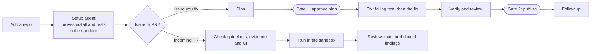

# NightShift

A self-hosted workbench for open-source work. It helps a **contributor** find an issue, fix it and
follow it up, and helps a **maintainer** check incoming pull requests. AI does the work; you approve
everything public.

- **Find where to contribute:** repos are ranked by how outside pull requests fare there (merged,
  closed, time to a first answer, AI rules), and every starter issue is checked live so you never pick
  one someone else is already fixing.
- **Fix an issue:** NightShift plans the fix, you approve the plan, it writes a test that fails first
  and then the fix inside a Docker sandbox, a second model reviews it, you answer a short understanding
  check, and you publish the PR from your own GitHub account, following the repo's AI policy.
- **Check a PR:** paste a pull request, or let NightShift check new PRs on repos you maintain. It checks
  the template and evidence, reads the PR's own CI, runs it in the sandbox (its tests must fail without
  the change and pass with it, and the tests related to the change must not regress), reviews it, and
  lists must-fix and should-fix findings. Posting the review is one click, never automatic.
- **Follow up:** review comments, red CI and replies on your published PRs reach "Needs you" on their
  own. NightShift drafts replies or a revision, pushed as a follow-up commit, never forced; when a merged
  fix leaves its issue open, it drafts a "fixed by" note.

It never merges, never force-pushes and never posts without a click from you.

> **Status:** pre-release, used daily. Of the 9 pull requests it has made to other people's projects,
> 3 are merged (for example [laya#62](https://github.com/aayushch/laya/pull/62)), 3 approved and 3
> waiting, none rejected, usually for under $1 each. The PR checker has been scored against
> maintainers' own decisions on pydantic, opentelemetry-python and opentelemetry-go-contrib
> (`nightshift bench`): it rarely blocks a PR maintainers merged, but still misses many they reject.
> See the [PRD](docs/PRD.md) for where it is going and the [backlog](docs/BACKLOG.md) for what is next.

## Quick start

You need Docker, Python 3.12 with [uv](https://docs.astral.sh/uv/), Node 20, the GitHub CLI, an
[OpenRouter](https://openrouter.ai) API key and a read-only GitHub token.

```bash
git clone https://github.com/MaheshPulivarthi18/NightShift.git && cd NightShift
cp .env.example .env                      # add OPENROUTER_API_KEY, GITHUB_TOKEN, NIGHTSHIFT_GITHUB_LOGIN
docker compose up -d                      # Postgres 16 with pgvector
uv sync
uv run alembic upgrade head && uv run nightshift db-setup
uv run nightshift sandbox build           # the base image repo code runs in
(cd frontend && npm install && npm run build)
uv run nightshift serve                   # http://127.0.0.1:8000
```

The full walkthrough, every setting and common problems: **[docs/SETUP.md](docs/SETUP.md)**.

## How it works



- **Checks, cheapest first:** a fix passes five checks in order, so a wrong change is caught before the
  slow ones run. The task's Checks tab shows each one as it runs:

  | Check | Cost | Catches |
  |---|---|---|
  | Plan check | ~$0.01, before any code | a plan that misreads the code (a second model reads it) |
  | Scope | free, instant | lock or built files the plan does not name, a change far bigger than planned |
  | Test | seconds | a test that passes without the fix, a fix that does not pass it |
  | Review | cents | an incomplete fix, missed code paths, unrelated changes (another model family) |
  | Full suites | minutes, once | regressions; they run after the Reviewer approves, and one goes back to the Coder |

- **Sandbox:** all repo code, including every PR under check, runs only in a Docker container: non-root,
  no capabilities, CPU, memory and process limits, a timeout on every command, and no keys or tokens
  inside. One image per repo, reused by every issue and PR in it.
- **Models:** every call goes through one gateway to OpenRouter. A router picks a model per agent,
  falls back on failure, keeps the Reviewer on a different model family from the Coder, and learns from
  outcomes. Spend caps are checked before every call; `nightshift kill` stops all of them.
- **Memory:** repo knowledge (environment, PR guide, code map) is built once per repo and reused; model
  answers are cached by their inputs; every call is recorded with its cost.
- **GitHub:** NightShift reads with a read-only token. Publishing, replies, reviews and claims use your
  own `gh` login, only after you approve them. A background sync (hourly by default) brings back new
  feedback, CI results and merges, and waits out a GitHub outage instead of failing every job.
- **Resume, not restart:** a stopped or revised task continues from where it stopped, keeping its change
  and test baseline, so a fix that fails at review is not paid for again from the plan.

## Use

The web app (`nightshift serve`) opens on **Overview**: what needs you across repos (plans to approve,
fixes to publish, review comments, red CI, incoming PR checks) and every repo at a glance. Each repo in
the sidebar has its own workspace (Overview, Issues & PRs, Map, Knowledge), and a chat beside every
issue or PR can run its next step. **Where to contribute** ranks your watchlist, **Track record** shows
what happened to every PR you made, and **Settings** holds the kill switch, spend, and the older pages
(models, jobs, all tasks, all PR checks, repos). The same work is available from the CLI:

```bash
uv run nightshift watch add owner/repo                  # add a repo
uv run nightshift sandbox setup owner/repo              # find and prove its install and test commands
uv run nightshift task plan owner/repo 123              # plan a fix for issue #123; stops at Gate 1
uv run nightshift task approve 1 && uv run nightshift task run 1
uv run nightshift task publish 1 --yes                  # Gate 2: opens the PR from your account
uv run nightshift task revise 1 --note "…"             # run it again from where it stopped, with a correction
uv run nightshift check-pr https://github.com/owner/repo/pull/45
uv run nightshift task from-pr https://github.com/owner/repo/pull/67   # follow up a PR you opened by hand
uv run nightshift bench owner/repo --merged 10 --closed 10              # score the PR checker; posts nothing
uv run nightshift models                                # which model each agent uses, and how each has done
uv run nightshift spend
uv run nightshift backup                                # dump the database to backups/
uv run nightshift kill                                  # block every model call; `nightshift resume` clears it
```

Run `uv run nightshift --help` (and `--help` on any command) for everything else.

## Documentation

| Document | What it covers |
| --- | --- |
| [docs/SETUP.md](docs/SETUP.md) | Installing and running NightShift, every setting, troubleshooting |
| [CONTRIBUTING.md](CONTRIBUTING.md) | Project layout, tests, conventions, how to send a change |
| [docs/PRD.md](docs/PRD.md) | The product spec: users, lifecycle, the memory harness, requirements, roadmap |
| [docs/BACKLOG.md](docs/BACKLOG.md) | Known bugs and planned work |

## Safety

The web app has no login: it binds to `127.0.0.1` and refuses cross-site writes. Do not expose it to a
network without putting authentication in front of it. Issue, PR and comment text is treated as
untrusted data, never as instructions.

## License

[Apache License 2.0](LICENSE).
