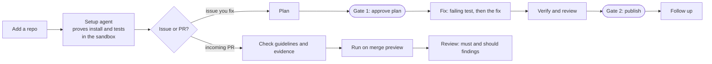

# NightShift

A self-hosted workbench for open-source work. It helps a **contributor** find an issue, fix it and
follow it up, and helps a **maintainer** check incoming pull requests. AI does the work; you approve
everything public.

- **Fix an issue:** NightShift plans the fix, you approve the plan, it writes a test that fails first
  and then the fix inside a Docker sandbox, a second model reviews it, and you publish the PR from your
  own GitHub account.
- **Check a PR:** paste a pull request; NightShift checks its template and evidence, runs it on the
  merge preview (its tests must fail without the change and pass with it), reviews it, and lists
  must-fix and should-fix findings. Nothing is posted.
- **Follow up:** review threads, reviews, comments and comments on the closing issue come back to you
  with drafted replies or a revision, pushed as a follow-up commit, never forced.

It never merges, never force-pushes and never posts without a click from you.

> **Status:** pre-release. The engine works end to end and has opened real, merged PRs
> (for example [ai-job-search#768](https://github.com/ai-job-search-dev/ai-job-search/pull/768)).
> The first release (R1) is being built: a repo-first workspace and a shared prompt builder.
> See the [PRD](docs/PRD.md) for where it is going.

## Quick start

You need Docker, Python 3.12 with [uv](https://docs.astral.sh/uv/), Node 20, the GitHub CLI, an
[OpenRouter](https://openrouter.ai) API key and a read-only GitHub token.

```bash
git clone https://github.com/MaheshPulivarthi18/NightShift.git && cd NightShift
cp .env.example .env                      # add OPENROUTER_API_KEY, GITHUB_TOKEN, NIGHTSHIFT_GITHUB_LOGIN
docker compose up -d                      # Postgres 16 with pgvector
uv sync
uv run alembic upgrade head && uv run nightshift db-setup
uv run nightshift sandbox build           # the base image repo code runs in
(cd frontend && npm install && npm run build)
uv run nightshift serve                   # http://127.0.0.1:8000
```

The full walkthrough, every setting and common problems: **[docs/SETUP.md](docs/SETUP.md)**.

## How it works



- **Sandbox:** all repo code, including every PR under check, runs only in a Docker container: non-root,
  no capabilities, CPU, memory and process limits, a timeout on every command, and no keys or tokens
  inside. One image per repo, reused by every issue and PR in it.
- **Models:** every call goes through one gateway to OpenRouter. A router picks a model per agent,
  falls back on failure, keeps the Reviewer on a different model family from the Coder, and learns from
  outcomes. Spend caps are checked before every call; `nightshift kill` stops all of them.
- **Memory:** repo knowledge (environment, PR guide, code map) is built once per repo and reused; model
  answers are cached by their inputs; every call is recorded with its cost.
- **GitHub:** NightShift reads with a read-only token. Publishing, replies and claims use your own `gh`
  login, only after you approve them.

## Use

The web app (`nightshift serve`) has Tasks, Repos, PR checks, Jobs and Models pages. The same work is
available from the CLI:

```bash
uv run nightshift watch add owner/repo                  # add a repo
uv run nightshift sandbox setup owner/repo              # find and prove its install and test commands
uv run nightshift task plan owner/repo 123              # plan a fix for issue #123; stops at Gate 1
uv run nightshift task approve 1 && uv run nightshift task run 1
uv run nightshift task publish 1 --yes                  # Gate 2: opens the PR from your account
uv run nightshift check-pr https://github.com/owner/repo/pull/45
uv run nightshift task from-pr https://github.com/owner/repo/pull/67   # follow up a PR you opened by hand
uv run nightshift models                                # which model each agent uses, and how each has done
uv run nightshift spend
uv run nightshift kill                                  # block every model call; `nightshift resume` clears it
```

Run `uv run nightshift --help` (and `--help` on any command) for everything else.

## Documentation

| Document | What it covers |
| --- | --- |
| [docs/SETUP.md](docs/SETUP.md) | Installing and running NightShift, every setting, troubleshooting |
| [CONTRIBUTING.md](CONTRIBUTING.md) | Project layout, tests, conventions, how to send a change |
| [docs/PRD.md](docs/PRD.md) | The product spec: users, lifecycle, the memory harness, requirements, roadmap |
| [docs/BACKLOG.md](docs/BACKLOG.md) | Known bugs and planned work |

## Safety

The web app has no login: it binds to `127.0.0.1` and refuses cross-site writes. Do not expose it to a
network without putting authentication in front of it. Issue, PR and comment text is treated as
untrusted data, never as instructions.

## License

[Apache License 2.0](LICENSE).
