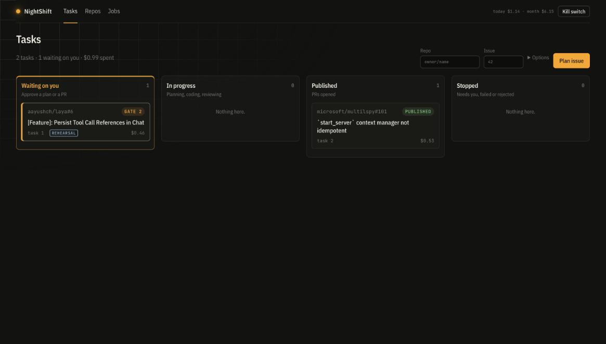
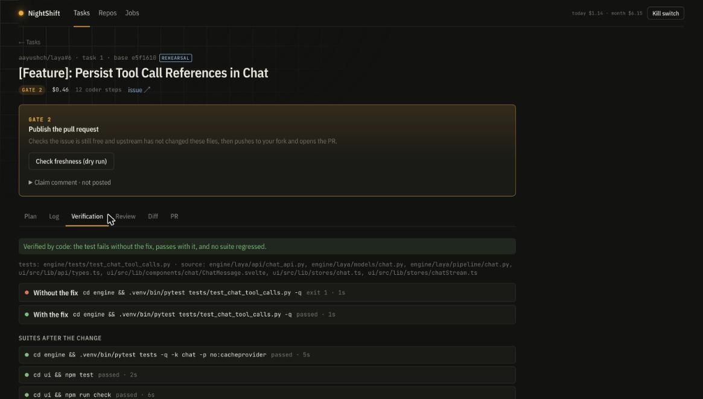
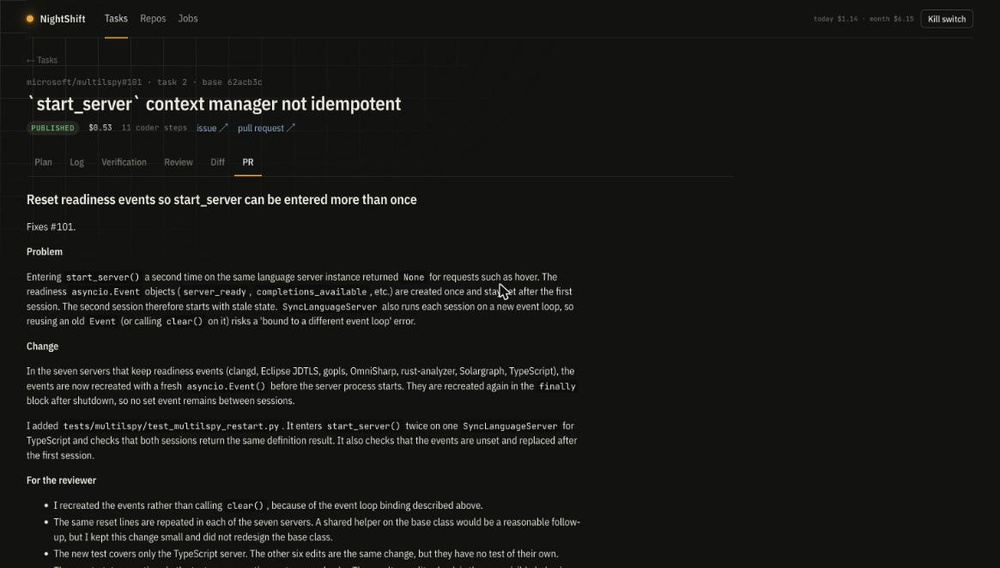
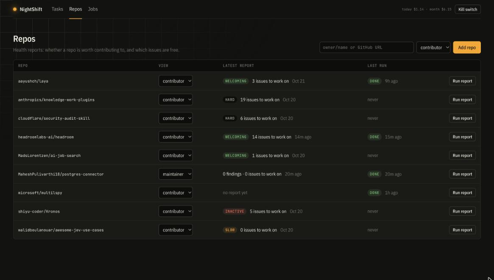
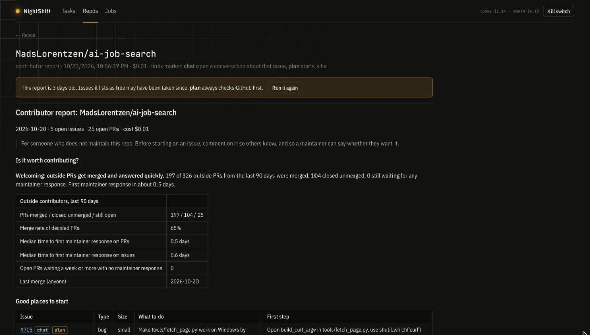
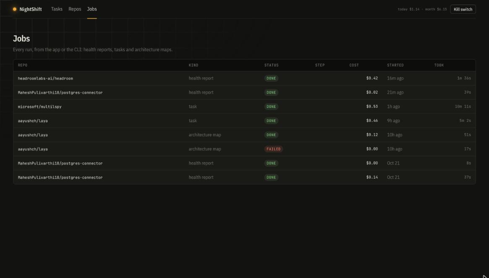

# NightShift

Agents that find open-source issues worth fixing and fix them, with you approving every step that
is public. Two parts:

1. **Repo Health Reports** (read-only): is a repo worth contributing to, and which issues are free.
2. **Contribution Worker**: plans a fix (Gate 1: you approve), writes a failing test and the fix in a
   Docker sandbox, verifies it by code, has it reviewed, drafts the PR, then opens it from your
   account only after Gate 2. First PR made this way:
   [microsoft/multilspy#169](https://github.com/microsoft/multilspy/pull/169).



## Repo Health Reports

Each watched repo has a role that picks the report:

- **contributor** (default): for repos you don't maintain. Is it worth contributing (outside PR merge rate, time to first maintainer response)? Which open issues are free and worth taking, which need a maintainer's OK first, and which are already being worked on?
- **maintainer**: backlog triage. Related clusters, duplicates, and which PRs can be closed, merged or need a decision, each with a reason and evidence checked by a separate Verifier.

### How reports are made

```
maintainer:  fetch -> link -> analyse_groups -> assess_prs -> verify -> report
contributor: fetch -> link -> scout -> contributor_report
```

| Node | Kind | What it does |
| --- | --- | --- |
| fetch | code | GitHub GraphQL, incremental after the first run; stores items in Postgres and embeds them locally |
| link | code | Candidate groups from explicit links plus pgvector similarity |
| analyse_groups | agent | **Relevance Analyst** confirms clusters and duplicates |
| assess_prs | agent | **PR Assessor** classifies open PRs using signals computed by code |
| verify | agent | **Verifier** checks each claim against its evidence only; unsupported claims are dropped |
| report | code | Markdown report and a stored snapshot, compared with the previous one |
| scout | code + agent | Contributor pulse and who is on which issue (code); **Opportunity Scout** judges which free issues are actionable, their size, and whether to ask first |
| contributor_report | code | Contributor Markdown report, compared with the previous one |

- **Orchestration:** LangGraph, checkpointed in Postgres, so a stopped run resumes with `--resume <run id>`.
- **Model access:** every Claude call goes through `nightshift.llm.LLMGateway`, which enforces the kill switch and budget caps, caches verdicts by input hash, and records cost per call.
- **Memory:** items and embeddings (repo memory), cached verdicts, and operator feedback that calibrates future reports.

## Setup

```bash
docker compose up -d            # Postgres 16 + pgvector
cp .env.example .env            # add ANTHROPIC_API_KEY (or NIGHTSHIFT_PROVIDER=openrouter + OPENROUTER_API_KEY)
                                # and a read-only GITHUB_TOKEN
uv sync
uv run alembic upgrade head     # app tables
uv run nightshift db-setup      # LangGraph checkpoint tables
```

## Use

```bash
uv run nightshift watch add aayushch/laya MadsLorentzen/ai-job-search   # contributor view
uv run nightshift watch add my-org/my-repo --role maintainer
uv run nightshift watch role aayushch/laya maintainer                   # switch views
uv run nightshift report run aayushch/laya
uv run nightshift report run --all
uv run nightshift report show aayushch/laya
uv run nightshift report feedback aayushch/laya "close_candidate:#42" --wrong --note "still wanted"
uv run nightshift spend
uv run nightshift kill          # blocks every model call; `nightshift resume` clears it
```

Reports are written to `reports/<owner>__<repo>/`.

## Sandboxes and repo context (Contribution Worker, M1)

Repo code only ever runs in a Docker container: no credentials or host files inside, a non-root
user with no capabilities, CPU, memory and process caps, and a timeout on every command. After a
repo's setup succeeds the container is saved as a per-repo image, so the next task skips the install.

```bash
uv run nightshift sandbox build                      # base image: Python, Node, uv, git, language servers
uv run nightshift sandbox try aayushch/laya \
  --setup "cd engine && uv venv -q .venv && uv pip install -q --python .venv/bin/python -r requirements-dev.lock" \
  --setup "cd ui && npm ci" \
  --test "cd engine && .venv/bin/pytest -q" --test "cd ui && npm test"

uv run nightshift context map aayushch/laya           # L1 architecture map: one Sonnet call per new commit
uv run nightshift context change aayushch/laya --base e5f1610 --patch fix.diff   # L3, no model calls
```

- **L1 architecture map:** code builds a source index inside the sandbox (imports for Python,
  TypeScript, Svelte and Rust; entry points; central files), then the **Cartographer** maps
  components and relationships, each citing a file. Code drops any path that does not exist.
  Stored per commit in `repo_context`.
- **L3 change context:** for a diff, the enclosing functions, their callers and called definitions
  (jedi and typescript-language-server via multilspy), plus code elsewhere that uses the same string
  keys. Code the diff did not change but probably should have is listed first.

Outputs go to `reports/<owner>__<repo>/context/`.

## Contribution tasks (M2)

```bash
uv run nightshift task plan aayushch/laya 6           # Planner; stops at Gate 1
uv run nightshift task approve 1 [--setup ...] [--test ...]   # or: task reject 1 --note "..."
uv run nightshift task run 1                          # setup, baseline, Coder, verification, Reviewer
uv run nightshift task show 1
```

- **Planner** (Sonnet): the issue fetched fresh, repo brief, architecture map and the files that
  mention the issue's terms (L2). Refuses an issue someone else has claimed (assigned, or an open PR
  that closes, cross-references or names it); set `NIGHTSHIFT_GITHUB_LOGIN` so yours do not count.
- **Coder** (Sonnet): reads, searches, edits and runs inside the sandbox, then submits.
- **Verification by code:** the targeted test must fail with the source changes taken out and pass
  with them, and every test command that passed at baseline must still pass.
- **Reviewer** (Sonnet, independent): judges every item of related code the diff did not change;
  changes it asks for go back to the Coder, up to `review_rounds` more times.
- Limits per task: `task_budget_usd` ($5), `task_minutes` (30), `coder_max_steps` (60). Nothing is
  posted to GitHub.

## Web app

```bash
cd frontend && npm install && npm run build   # once, and after UI changes
uv run nightshift serve                        # http://127.0.0.1:8000
```

A React + TypeScript app (`frontend/`) on a JSON API (`/api`); the server renders no HTML itself.

- **Tasks:** lanes by stage, "Waiting on you" first. A task page puts the gate to act on at the top
  (Gate 1: approve the plan and its commands; Gate 2: freshness check, then publish after typing the
  repo name), then Plan, live Log, Verification, Review, Diff and PR.
- **Repos:** watchlist with view, latest report and last run; add repos, switch view, run a report.
- **Report:** the health report, with **chat** and **plan** links next to every issue.
- **Jobs:** every run (reports, tasks, maps) from the app or the CLI, with a live log, stop and resume.
- **Chat:** talk to Claude about one issue or PR; it reads the repo's code, drafts, never posts.
- Spend today and this month, and the kill switch, are always in the header.

| | |
| --- | --- |
|  |  |
| **Task at Gate 2:** freshness dry run, and the fix verified by code (fails without it, passes with it) | **PR draft** in the repo's own style; the Testing section comes from the real runs |
|  |  |
| **Repos:** verdict, issues to work on, last run | **Report:** warns when it is old; **chat** and **plan** next to every issue |
|  | |
| **Jobs:** every report, task and map run with cost and duration | |

The app has no login, so the server binds to 127.0.0.1 and refuses cross-site writes. Put it behind
authentication before exposing it. For UI work, `npm run dev` in `frontend/` proxies `/api` to a
running `nightshift serve`.

Known bugs and planned work: [docs/BACKLOG.md](docs/BACKLOG.md).

## Development

```bash
uv run pytest        # unit tests, plus Postgres-backed tests when docker compose is up
uv run ruff check src tests
uv run mypy src
```
