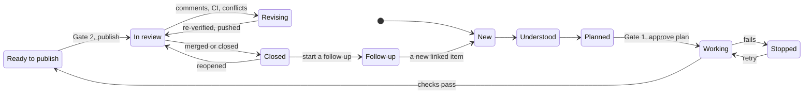
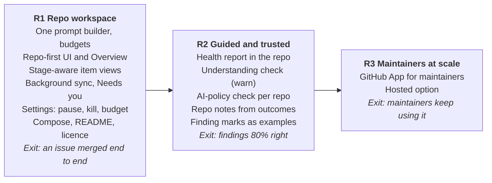

# PRD v3: NightShift — open-source contribution and review workbench

**Status:** Draft v3, 2026-10-26 (replaces v2 of 2026-10-20) · **Author:** [@MaheshPulivarthi18](https://github.com/MaheshPulivarthi18)

This is the product spec contributors build against. Release tags (R1, R2, R3) mark what ships when; see [Built today, gaps and roadmap](#built-today-gaps-and-roadmap).

## Summary

NightShift is a self-hosted workbench for open-source work: it helps a contributor find, fix and follow up an issue, and helps a maintainer check incoming pull requests, with AI doing the work and a person approving everything public.

One app serves both sides. You pick a repo; NightShift learns it once (setup, tests, PR rules, code map) and reuses that knowledge for every issue, PR and chat in it. Each issue or PR is an item that follows a clear path with gates, and every new comment on GitHub lands in one "Needs you" list.

**The promise:** work you can put your name on. Every fix is run in a sandbox, fails before and passes after, is reviewed by a second model, and is explained in plain words before you publish it. Every PR check is backed by running the code, not by reading it.

NightShift never merges, never force-pushes and never posts without a click from you. It runs locally first; a hosted GitHub App for maintainers comes later.

## What changed from v2

v2 described an autonomous fleet maintaining the operator's own repos. Building it showed the real need is a guided tool for contributors and maintainers, so v3 changes the product, not just the plan.

| Area | v2 (2026-10-20) | v3 |
| --- | --- | --- |
| Product | Fleet of agents maintaining connected repos 24/7 | Workbench for contributing to and reviewing any public repo |
| Users | Operator first, maintainers in Phase 3 | Contributors and maintainers from the start, one app |
| Trigger | GitHub webhooks | The user: add a repo, pick an item, paste a PR; background sync for comments |
| Writes to GitHub | GitHub App installation token via the Publisher | The user's own `gh` login, only after a click; App later |
| Models | Claude through the Anthropic SDK, LangGraph | Any model through OpenRouter; a router picks per agent with fallbacks |
| Sandbox | Docker + gVisor on a VM, egress proxy | Docker on the user's machine; per-repo environment images |
| Phone control | Telegram bot | Dropped: NightShift is a desktop tool, so pause and kill live in the app |
| PR review | Posts one comment on every PR | Checks a PR privately (guidelines, evidence, run, review); posting is a choice |
| Memory | Verdict cache, repo memory | A harness: layered, cached, budgeted, visible context (see The harness) |

Kept from v2: the gates, fail-before and pass-after tests, an independent reviewer, the context ladder, cost caps, and "untrusted text is data".

## Users and core use cases

Two users share one app; the same person is often both.

| User | Wants | Success looks like |
| --- | --- | --- |
| Contributor | Know where to start, make a fix that gets merged, answer reviewers without missing anything | PRs merged and staying merged; no comment left unanswered |
| Maintainer | Know which PRs are safe, which need work, and why, without running each one by hand | Fewer hours per review; findings that hold up |
| Operator (the person running NightShift) | Stay safe and within budget | Spend under the cap; nothing public without a click |

**Core use cases**

1. **Pick a repo and understand it.** Add a repo; see its numbers, whether outside PRs get merged, and what NightShift knows about it.
2. **Find work.** See issues worth doing, ranked, with a reason; skip ones someone else is already fixing.
3. **Fix an issue.** Read the plan and approve it; NightShift fixes it in the sandbox with a test that fails first; review the diff, tests and evidence; publish.
4. **Follow up.** A reviewer comments on your PR or its issue; NightShift brings it to Needs you with a drafted reply or a revision; you approve.
5. **Check an incoming PR.** Paste a PR; NightShift checks guidelines and evidence, runs it, reviews it, and lists must-fix and should-fix findings; you mark each right or wrong and draft the review.
6. **Ask.** Chat about any repo, issue or PR, with the repo's knowledge already loaded.
7. **Stay in control.** Pause, kill, set the budget and the approval rules in one place.

## Product model

Everything is a **repo** holding **items**; each item follows one of three paths, and every gate shows up in **Needs you**.

- **Repo:** a public GitHub repo you added. It has knowledge built once (environment, PR guide, code map, your notes), a health report, and a list of items.
- **Item:** one issue or PR, with its linked issue or PR, its own worktree, timeline, chat and memory. Labelled by role: Yours, Incoming PR, Issue, Practice run.
- **Gate:** a stop where a person decides. Nothing public happens between gates without one.

**Path A: an issue you fix (contributor)**

1. Understand: what the issue asks, whether maintainers want it, whether someone is already on it.
2. Plan, then **Gate 1**: approve the plan, the files, the cost estimate and the reproduction.
3. Fix in the sandbox: a test that fails first, then the fix; full suite before and after.
4. Verify: an independent review on a different model family; safety scan of the diff.
5. **Gate 2**: diff, tests before and after, evidence, PR title and body; edit, then publish.
6. In review, then Closed: becomes Path C until GitHub merges or closes it (see Lifecycle and actions).

**Path B: an incoming PR (maintainer)**

1. Check guidelines (template, linked issue) and evidence.
2. Run it on the merge preview: its tests fail without the change and pass with it; the linked issue's case is fixed; no regressions.
3. Review: must-fix and should-fix findings, each with file, line and proof.
4. **Gate**: mark each finding right or wrong, edit the drafted review, post it or keep it private.

**Path C: your published PR**

1. Watch: new review threads, reviews, comments, and comments on the closing issue.
2. For each: reply, address with a change, or dismiss.
3. **Gate**: approve replies, and the follow-up diff when there is one (pushed, never forced).

## Lifecycle and actions

An item is never finished at Publish: it stays live through review, moves to **Closed** when GitHub closes it, and can come back. Every stage shows only the actions that fit it; actions marked **Public** post or push to GitHub and always wait for a click.

In review loops through Revising as often as reviewers ask; Closed can return to In review when a PR is reopened, or start a linked follow-up item.

**1. An issue you fix**

| Stage | What happens | Actions |
| --- | --- | --- |
| New | Found by Find work, or added by you | Explain it · Plan a fix · Ask the maintainers (Public) · Practice run · Hide |
| Understood | Plain explanation, maintainer stance, who else is on it | Plan a fix · Claim it (Public) · Hide |
| Planned (Gate 1) | Plan, files, reproduction result, cost estimate | Approve plan · Add a note and re-plan · Change model · Stop |
| Working | Setup, failing test, fix, full suite, independent review | Pause · Stop · Live log |
| Stopped | Why, in one sentence; work saved | Retry with a note · Retry with another model · Hide |
| Ready to publish (Gate 2) | Diff, tests before and after, evidence, PR text | Edit PR text · Explain the change · Publish (Public) · Keep as practice · Reject |
| In review | The PR is open | See part 2 |
| Closed | Merged, closed, superseded or not planned | See part 2 |

**2. Your PR, after publishing**

| State (from sync) | What you see | Actions |
| --- | --- | --- |
| Waiting for review | Days waiting against this repo's usual reply time | Nudge the maintainer (Public, after N days) · Edit PR text (Public) · Convert to draft (Public) |
| New comments or changes requested | Each comment with a suggested action | Reply (Public) · Address with a change, re-verify, push (Public) · Dismiss |
| CI failing | Which check failed, its log summarised | Fix CI: a revision from the failing log, push (Public) |
| Behind main or conflicting | Which files conflict | Update the branch by merging main in, never force (Public), then re-verify |
| Approved | Waiting for a merge | None needed |
| Any open state |  | Explain the change · Re-verify on latest main · Withdraw the PR (Public) |
| Merged | Moves to Closed: summary, days to merge, cost | Accept learned repo notes · Start a follow-up · Hide |
| Closed without merge | Moves to Closed with the maintainer's reason | Reopen the PR (Public) · Revise from its code · Start a follow-up · Hide |
| Issue reopened after merge | Back to Open and Needs you | Start a follow-up fix |

**3. An incoming PR, as maintainer**

| Stage | What happens | Actions |
| --- | --- | --- |
| New | Pasted by you, or synced (opt-in per repo) | Check it · Hide |
| Checking | Guidelines, evidence, run on the merge preview, review | Live log · Stop |
| Checked | Verdict and must and should findings | Mark each finding Right or Wrong · Draft review · Re-run checks |
| Reviewed | Your review drafted | Edit · Post the review (Public) · Keep it private |
| Updated by the author | New commits | Re-check what changed |
| Closed | Merged or closed on GitHub | Moves to Closed; Right and Wrong marks kept as examples for the repo |

**Everywhere:** chat about any item; Needs you collects gates, new comments, failing checks and stopped runs; each repo's list has **Open** and **Closed** tabs; Hide removes an item from view without deleting it. Closed items feed the track record on Overview (opened, merged, days to merge, merge rate).

## Screens

A left sidebar holds Overview and the repos; choosing a repo fills the screen with its context. The item's middle panel changes with its stage; the chat stays beside it.

| Screen | Holds |
| --- | --- |
| Overview (global) | Needs you across repos; totals (open issues and PRs, your PRs by state, PRs checked); repos table with "worth contributing?"; track record (opened, merged, time to merge) |
| Repo: Overview | Open issues, open PRs, merged in 30 days, contributors; contributor health verdict; your work here |
| Repo: Find work | Ranked issues worth doing, each with a reason; items someone else is fixing marked |
| Repo: Health report | Clusters, duplicates, close candidates, ready to merge, needs a decision; mark each right or wrong |
| Repo: Issues & PRs | Item list with Open and Closed tabs (filters: Yours, Incoming, Issues) + the selected item + its chat |
| Repo: Knowledge | Environment, PR guide, code map, repo brief, your notes; each with freshness and Refresh, Edit or Forget |
| Settings | Pause, Kill, daily and monthly budget, approval rules, models per agent, sync interval and what to follow |
| Activity | Every run with its live log, trace, models used and cost |

**Item middle panel by stage**

| Stage | Shows | Actions |
| --- | --- | --- |
| New issue | Plain explanation, maintainer stance, who else is on it | Explain, Plan a fix, Ask the maintainers |
| Plan ready (Gate 1) | Plan, files, reproduction result, cost estimate, model | Approve, Add a note and re-plan, Stop |
| Working | Live log, cost meter, step | Pause, Stop |
| Ready to publish (Gate 2) | Diff, tests before and after, evidence, safety scan, PR text | Edit, Publish, Practice run only, Reject |
| Stopped | Why, in one sentence, and what was saved | Retry with a note, Change model, Archive |
| Checked PR | Verdict, findings must and should, what was run | Mark right or wrong, Draft review, Re-run |
| Feedback | New comments with suggested action, drafted replies | Reply, Address with a change, Dismiss |
| In review | PR state from sync: waiting, new comments, CI failing, behind or conflicting, approved | The actions for that state (Lifecycle and actions) |
| Closed | Outcome, summary, days to merge, cost, learned repo notes | Reopen, Revise from its code, Start a follow-up, Explain the change, Hide |

Plain words throughout: "Approve plan" and "Publish", not Gate 1 and Gate 2; "Practice run" for work that will not be published; "Hidden" instead of archived.

## The harness: memory, context and caching

The stack is sound; what it lacks is one harness that decides what every model call sees. Today each agent builds its own prompt, so the one-shot agents barely use the prompt cache and repo knowledge is rebuilt or re-sent in slightly different forms.

**Measured, last 30 days (from the LLM ledger)**

| Agent | Prompt tokens | Read from cache | Spend |
| --- | --- | --- | --- |
| Coder (multi-turn loop) | 1,210,706 | 3,108,575 | $2.44 |
| Opportunity scout | 476,054 | 48,926 | $3.37 |
| Reviewer | 434,897 | 20,866 | $2.75 |
| Planner | 186,469 | 6,274 | $0.52 |
| Setup agent | 179,540 | 5,677 | $0.26 |
| PR writer | 100,786 | 2,590 | $0.34 |

The Coder's loop already reuses its prefix turn after turn. The one-shot agents read almost nothing from cache, because each puts different text first. They are where the harness saves money.

**What the harness does**

1. **One prompt builder, stable-first.** Every call is assembled in the same order: agent instructions, repo knowledge, item, task-specific code, latest turns. The same inputs give the same bytes (sorted, no timestamps), with cache breakpoints after the repo layer and after the item layer. Anthropic and Gemini models need those explicit breakpoints; OpenAI-style providers cache a repeated prefix on their own; a stable prefix helps both.
2. **Layers with owners and budgets.** Each layer has a token budget; when it overflows it is summarised or retrieved, never cut silently.
3. **Freshness by provenance.** Each piece of knowledge records what it was built from (commit, hashes of CONTRIBUTING, the PR template, manifests and lockfiles). It is rebuilt only when those change, and shows Fresh or Stale until then.
4. **Incremental sync.** A cursor per repo fetches only what changed since the last sync, with conditional requests so unchanged pages cost nothing against GitHub's rate limit. Comments are stored cleaned, once.
5. **Reuse of answers.** The existing verdict cache (same inputs, same answer) extends to file reads by commit and path, and to chat tool calls.
6. **Reuse of environments.** One environment image per repo; each item gets a git worktree from a cached clone and a fresh container per run.
7. **Memory that learns, with consent.** After an item ends, NightShift proposes repo notes from what happened ("maintainer asked for smaller PRs"); you accept or edit them. Right and wrong marks on findings are kept per repo and shown to agents as examples.
8. **Visible.** A Context panel on every chat and run shows each layer, its size and whether it came from cache; Overview shows time and tokens saved by reuse.

**Layers and budgets (proposed)**

| Layer | Holds | Scope | Rebuilt when | Budget |
| --- | --- | --- | --- | --- |
| Instructions | Agent prompt and rules | Agent | NightShift version changes | fixed |
| Repo knowledge | Brief, PR guide, environment summary, your notes | Repo | Its sources change | 3k tokens |
| Code map | Components, paths, relationships | Repo at a commit | Default branch moves and the map is used | 4k tokens |
| Item | Issue or PR, cleaned comments, plan, decisions, run results | Item | A new comment or run | 6k tokens, older parts summarised |
| Task code | Relevant files, change context, on-demand reads | One call | Every call | 8k tokens |
| Chat | Summary of older turns + the last 6 turns | Chat | Every turn | 2k summary |

**Targets (proposed):** at least 60% of prompt tokens read from cache across all agents; a second item in a set-up repo has a ready sandbox in about a minute (the saved recipe already did headroom in 72 s); no layer over budget without a summary.

## Agents and model routing

Every model call goes through one gateway to OpenRouter; a router picks the model per agent, falls back on failure, and learns from outcomes. No agent is tied to one vendor.

| Agent | Job | Default route |
| --- | --- | --- |
| Setup | Find working install and test commands in the sandbox | Light model, escalates after 2 failed attempts |
| Planner | Plan, files, reproduction, cost estimate | Judgement model; large plans start one step up |
| Coder | Failing test, then the fix, in the sandbox | Coding model; escalates once on failure |
| Reviewer | Independent check of the diff | A different model family from the Coder |
| PR checker | Plan the checks of an incoming PR and judge the results | Judgement model |
| PR writer | PR text, commit messages, replies | Light model |
| Chat | Answers about a repo, issue or PR | Chosen per chat |
| Health agents | Clusters, duplicates, PR verdicts, verifier | Light to mid models |

**Rules:** fall back on an API error, refusal or unusable output, but not on account errors (401, 402, 403: those stop and ask the user). Demote a model that fails 3 or more and 30% or more of recent calls; promote one that beats the default by 20 points over 5 or more tasks. The user can pin a model per agent or per run.

## Sandbox and environments

All repo code, including every PR under check, runs only inside a Docker container on the user's machine; nothing from a repo runs on the host.

- **Container:** non-root, all capabilities dropped, CPU, memory and process limits, a timeout on every command. No API keys or GitHub tokens inside; the agent loop runs outside and sends commands in.
- **Environment per repo:** the Setup agent reads CI workflows, dev containers, contributing guides and toolchain files, tries commands, and saves what works as a recipe and an image (`nightshift-env:<hash>`). Later items try the recipe first, with no model call.
- **Worktree per item:** each item works in its own git worktree on the repo's one image, so two items in one repo never collide and no item needs its own image. An item gets a separate image only when you ask for one (for example, to try a different dependency version).
- **Results:** ready, blocked (with the reason) or failed. A repo whose tests cannot run is check-only: PRs are reviewed but not claimed as verified.
- **Later:** an egress allowlist (package registries and GitHub reads only) and gVisor when running on a server.

## Safety and community rules

NightShift posts nothing, pushes nothing and claims nothing without a click, and treats all GitHub text as data.

- **Credentials:** API keys live only in `.env`. NightShift's own GitHub token is read-only; publishing uses the user's `gh` login with other tokens stripped from the environment.
- **Prompt injection:** issue, PR, comment and README text goes inside delimited untrusted blocks; it can shape the work only within the item's scope.
- **Output checks before publishing:** no edits to CI workflows, CODEOWNERS or forbidden paths; no secrets; no unrelated files; the repo's PR template sections present.
- **Pushes:** follow-ups apply on top of the published branch and are never forced. If the Reviewer's own call fails or falls back, Publish shows a warning; publishing stays allowed.
- **Claims:** a claim comment posts once (atomic guard); a freshness check stops work if someone else claimed the issue or opened a PR.
- **Community:** follow each repo's contributing guide, CLA and AI-disclosure policy. The "Generated by NightShift" line is asked at every Publish (off by default), unless the repo's policy requires disclosure. Warn, but allow publishing, when the user has not shown they understand the change (understanding check). A per-repo limit on open PRs avoids spamming maintainers.

## Functional requirements

Requirements are numbered fresh for v3 and tagged with the release that ships them (R1 = first public release).

| ID | Requirement | Release |
| --- | --- | --- |
| FR-1 | Add a repo by URL; NightShift sets up its environment and builds its knowledge, showing progress | R1 |
| FR-2 | Overview shows Needs you across repos, totals, a repos table and a track record | R1 |
| FR-3 | Repo Overview shows open issues, open PRs, merged in 30 days, contributors and a contributor health verdict | R1 |
| FR-4 | Find work ranks issues with a reason and marks ones someone else is fixing | R1 |
| FR-5 | Every issue or PR is an item with a timeline, a chat and its own worktree | R1 |
| FR-6 | Path A: plan with reproduction; Gate 1; fix with a fail-first test; independent review; Gate 2 with diff, tests, evidence and editable PR text | R1 |
| FR-7 | Path B: check a PR on its merge preview; must and should findings with proof; mark right or wrong; draft a review | R1 |
| FR-8 | Path C: fetch review threads, reviews, comments and closing-issue comments; reply, address or dismiss; follow-up pushed without force | R1 |
| FR-9 | Background sync runs when the app starts and then every hour while it runs (interval set in Settings), with Sync now to run it at once. It follows your PRs and their linked issues; incoming PRs only in repos where you turn that on. New comments land in Needs you without a page refresh | R1 |
| FR-10 | The harness builds every prompt (see The harness); each run and chat shows its context and cache use | R1 |
| FR-11 | Knowledge tab: each piece shows freshness and can be refreshed, edited or forgotten | R1 |
| FR-12 | Settings: pause, kill, daily and monthly budget, approval rules, models per agent, sync interval and what to follow, sandbox images | R1 |
| FR-13 | A stopped item says why in one sentence and offers retry with a note or another model | R1 |
| FR-14 | Activity: every run's live log, trace, models and cost | R1 |
| FR-15 | Health report: clusters, duplicates, close candidates, ready to merge, needs a decision; diff from the last report | R2 |
| FR-16 | Understanding check before publishing (warn, allow) and AI-policy check per repo | R2 |
| FR-17 | Proposed repo notes from outcomes, accepted by the user | R2 |
| FR-18 | GitHub App for maintainers: checks posted on PRs of repos that install it | R3 |
| FR-19 | Each repo's list has Open and Closed tabs; sync moves an item to Closed when its PR is merged or closed or its issue is closed, and back to Open when reopened | R1 |
| FR-20 | Sync reads each open PR's review state, CI checks and mergeability; the item shows that state and its actions (see Lifecycle and actions) | R1 |
| FR-21 | A closed item shows its outcome, a summary, days to merge and cost, and offers Reopen, Revise from its code, Start a follow-up and Hide | R1 |
| FR-22 | Update the branch (merge main in, never force) and Fix CI (a revision from the failing log), each re-verified before the push | R1 |
| FR-23 | Explain the change is available on every item from Ready to publish onward, including closed ones | R1 |
| FR-24 | Image hygiene, like CI: one image per repo; when a newer one is saved, the older one is deleted once no open item uses it. When an item closes, a separate image it asked for is offered for deletion; when a repo's last open item closes, its image is offered for deletion too, with its size and the rebuild time; when a repo is removed, so is its image. Settings shows disk used per repo, with Delete | R1 |

## Non-functional requirements and success metrics

The north star is **merged PRs that stay merged** for contributors and **maintainers who keep using the PR checker**.

| Area | Requirement |
| --- | --- |
| Durability | Every run's state is in Postgres; a crash resumes or marks the run stale within 3 minutes; publishing and claims are idempotent |
| Cost | Daily and monthly caps checked before every model call; spend shown per run, item, repo and merged PR |
| Context | Every prompt within its layer budgets; context and cache use visible per call |
| Speed | A second item in a set-up repo starts in about a minute; a PR check finishes in under 15 minutes |
| Rate limits | GitHub calls use conditional requests and back off on 403 or 429 |
| Privacy | Runs locally; code and data stay on the user's machine except model calls |
| Release | One-command start (Docker Compose), README and docs, the Apache-2.0 licence |

| Metric | Definition | Target |
| --- | --- | --- |
| Merge rate | Your NightShift PRs merged ÷ opened | 40% or more |
| Stays merged | Merged PRs not reverted within 30 days | 98% or more |
| Finding accuracy | PR-check findings marked right ÷ marked | 80% or more |
| Cache share | Prompt tokens read from cache ÷ all prompt tokens | 60% or more |
| Cost per merged PR | Total spend ÷ merged PRs | Set after the first month |
| Missed comments | Comments on your PRs not surfaced within one sync | 0 |

## Built today, gaps and roadmap

The engine is mostly built; the gaps are the harness, the repo-first UI and release work.

| Part | Built today | Gap |
| --- | --- | --- |
| Path A: fix an issue | Planner with reproduction, Gate 1, Coder with fail-first check, Reviewer, Gate 2 with editable PR text | Shown as tasks, not inside a repo; stage-aware item view |
| Path B: check a PR | Guidelines, evidence, run on merge preview, review, must and should findings | Mark right or wrong; drafted review; lives on its own page |
| Path C: follow up | Feedback from threads, reviews, comments and closing issue; replies; follow-up commits | Background sync and Needs you; today it is fetched on demand |
| Setup and sandbox | Setup agent, recipes, environment images, limits | Per-item worktrees from a cached clone |
| Models | OpenRouter gateway, router, fallbacks, learning from outcomes | Per-agent pinning in Settings |
| Memory and context | Verdict cache, recipes, environment, code map per commit, change context, cache-read tokens in the ledger | One prompt builder, layer budgets, provenance, chat summaries, Context panel |
| Health report | Fetch, link, clusters, PR verdicts, verifier, report pages | Inside the repo view; right or wrong marks |
| UI | Tasks, Repos, PR checks, Jobs, Models pages | Repo-first layout, Overview, Settings with pause and kill |
| Release | Tests (about 176), Alembic migrations | Docker Compose, README, docs, licence |

No dates yet: R1 is the next build, starting with the prompt builder, because every later screen shows what it records.

## Decisions and open questions

**Decided since v2**

| Decision | Answer |
| --- | --- |
| Product shape | One app for contributors and maintainers, repo-first, items mixed and labelled |
| Structure | One repo, one workspace; issues and PRs are items with their own worktrees; setup and PR guide shared |
| Understanding check | Warn, allow publishing |
| AI disclosure | Follow each repo's policy; the "Generated by NightShift" line is optional: a checkbox at every Publish, off by default |
| Hosting | Self-hosted and local first; hosted later |
| Maintainer side | Local PR checker first; GitHub App later, created with the user's approval |
| Models | OpenRouter only; Claude allowed but not required; router with defaults |
| Reviewer fails or falls back | Warn at Publish; publishing stays allowed |
| Layer budgets and cache target | Start with the proposed budgets and a 60% cache target; adjust once 20 runs are measured |
| Background sync | On app start, then hourly while the app runs; interval in Settings; Sync now button; follows your PRs and their issues, incoming PRs per repo opt-in |
| Health report | R2 |
| Licence | Apache-2.0: explicit patent grant and contribution terms, common for developer tools |
| Phone control | Dropped: a desktop tool needs pause and kill in the app, not on a phone |

**Still open**

None right now. New questions go here as R1 is built.
